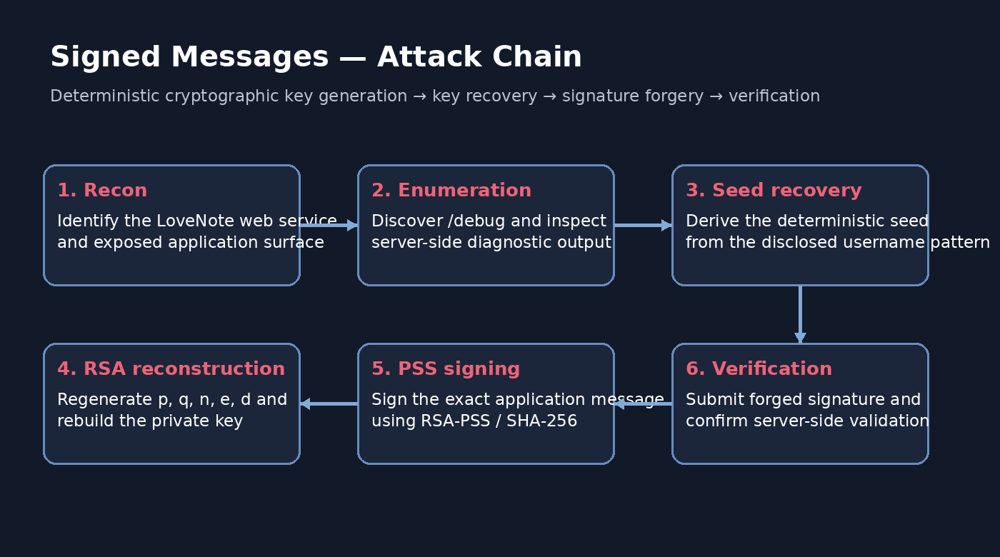
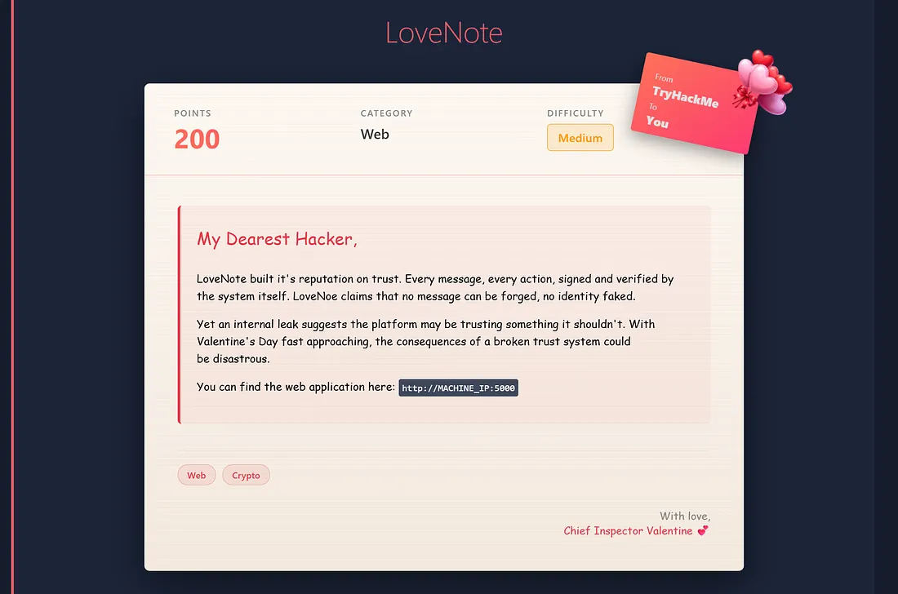
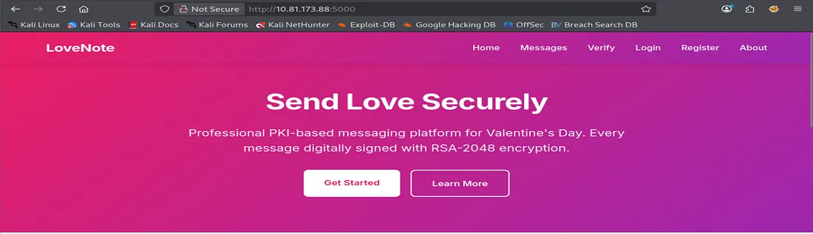
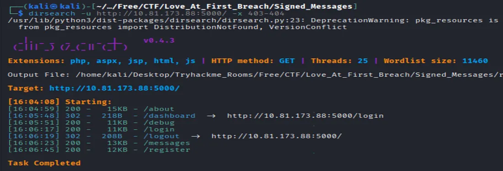
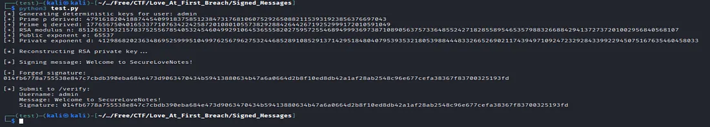
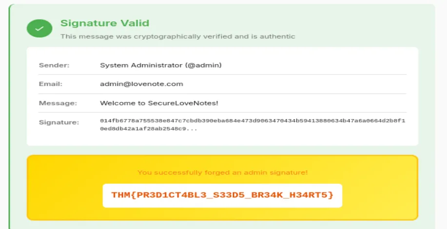

<div class="ctf-hero">

  <h1>Signed Messages</h1>

  <p>
    A technical walkthrough of a cryptographic trust failure in the LoveNote web application from the TryHackMe room Love at First Breach. The investigation follows the documented path from web enumeration and deterministic seed disclosure to RSA private-key reconstruction and RSA-PSS signature forgery.
  </p>

  <div class="ctf-badges">
    <span class="ctf-badge">TryHackMe</span>
    <span class="ctf-badge">Medium</span>
    <span class="ctf-badge">Web Security</span>
    <span class="ctf-badge">Cryptography</span>
    <span class="ctf-badge">RSA-PSS</span>
  </div>

</div>

## Quick Overview

<div class="ctf-card-grid">

  <div class="ctf-card">
    <div class="ctf-card-title">Platform</div>
    <div class="ctf-card-value">TryHackMe</div>
  </div>

  <div class="ctf-card">
    <div class="ctf-card-title">Room</div>
    <div class="ctf-card-value">Love at First Breach</div>
  </div>

  <div class="ctf-card">
    <div class="ctf-card-title">Task</div>
    <div class="ctf-card-value">Signed Messages</div>
  </div>

  <div class="ctf-card">
    <div class="ctf-card-title">Difficulty</div>
    <div class="ctf-card-value">Medium</div>
  </div>

  <div class="ctf-card">
    <div class="ctf-card-title">Core Finding</div>
    <div class="ctf-card-value">Deterministic RSA Key Generation</div>
  </div>

  <div class="ctf-card">
    <div class="ctf-card-title">Outcome</div>
    <div class="ctf-card-value">RSA-PSS Signature Forgery</div>
  </div>

</div>

## Navigation

<div class="ctf-toc">

<div class="ctf-toc-title">Documentation Map</div>

<ul>
  <li><a href="#mission">Mission and Executive Summary</a></li>
  <li><a href="#assessment-objectives">Assessment Objectives</a></li>
  <li><a href="#target-information">Target and Lab Information</a></li>
  <li><a href="#attack-chain">Attack Chain</a></li>
  <li><a href="#reconnaissance">Reconnaissance</a></li>
  <li><a href="#application-mapping">Application Mapping</a></li>
  <li><a href="#directory-enumeration">Directory Enumeration</a></li>
  <li><a href="#cryptographic-disclosure">Cryptographic Disclosure</a></li>
  <li><a href="#rsa-key-reconstruction">RSA Key Reconstruction</a></li>
  <li><a href="#signature-forgery">Signature Forgery</a></li>
  <li><a href="#signature-verification">Signature Verification</a></li>
  <li><a href="#key-finding">Core Security Finding</a></li>
  <li><a href="#flag">Flag</a></li>
  <li><a href="#security-recommendations">Security Recommendations</a></li>
  <li><a href="#tools-and-techniques">Tools and Techniques</a></li>
  <li><a href="#related-documentation">Related Documentation</a></li>
  <li><a href="#responsible-use">Responsible Use</a></li>
  <li><a href="#conclusion">Conclusion</a></li>
</ul>

</div>

## Mission and Executive Summary

The objective of the **Signed Messages** challenge is to investigate how a web application's cryptographic trust model can fail when RSA key generation is deterministic and the key-generation process becomes discoverable.

The LoveNote application provides signed and verified messaging. The documented investigation identifies a `/debug` endpoint that exposes information about deterministic seed construction and RSA factor derivation. With the seed reproducible locally, the same RSA parameters can be reconstructed and used to create an RSA-PSS signature that the application's verification endpoint accepts as authentic.

The central lesson is that selecting a recognized cryptographic algorithm is not sufficient. Secure key generation, private-key protection, appropriate cryptographic parameters, and correct verification behavior are all essential to preserving message authenticity.

## Assessment Objectives

The documented assessment focuses on:

- Mapping the LoveNote application's exposed functionality.
- Discovering additional application routes through directory enumeration.
- Examining the information disclosed by the `/debug` endpoint.
- Understanding the deterministic RSA key-generation process described by the debug output.
- Reconstructing the RSA parameters using the recoverable seed.
- Forging an RSA-PSS signature using the reconstructed private key.
- Confirming that the application's verifier accepts the forged signature.
- Identifying practical controls that could prevent the documented failure.

## Target and Lab Information

| Property | Documented value |
|---|---|
| Platform | TryHackMe |
| Room | Love at First Breach |
| Task | Signed Messages |
| Application | LoveNote |
| Category | Web security and cryptography |
| Difficulty | Medium |
| Key-generation weakness | Deterministic RSA key generation |
| Signature scheme | RSA-PSS |
| Hash function | SHA-256 |
| Verification endpoint | `/verify` |
| Final result | Forged signature accepted as authentic |

No target IP address, hostname, application version, or additional service details were provided in the source document.

## Attack Chain

The following diagram is the original evidence reference for the documented attack path.



<div class="attack-chain">

  <div class="attack-step">Reconnaissance</div>
  <div class="attack-arrow">→</div>
  <div class="attack-step">Directory Enumeration</div>
  <div class="attack-arrow">→</div>
  <div class="attack-step">/debug Disclosure</div>
  <div class="attack-arrow">→</div>
  <div class="attack-step">Seed Recovery</div>
  <div class="attack-arrow">→</div>
  <div class="attack-step">RSA Key Reconstruction</div>
  <div class="attack-arrow">→</div>
  <div class="attack-step">RSA-PSS Forgery</div>
  <div class="attack-arrow">→</div>
  <div class="attack-step">/verify Acceptance</div>

</div>

The sequence shows how information disclosure can undermine cryptographic security: once the deterministic key-generation process is exposed and reproducible, the attacker no longer needs to break RSA mathematically in the conventional sense.

## Reconnaissance

The initial investigation identifies the LoveNote application and its signed-message functionality. The application presents a workflow in which messages are signed and subsequently verified.

### Room and Application Overview



This evidence documents the challenge context and the initial application surface.

The key reconnaissance objective is to understand what the application exposes before investigating its cryptographic implementation.

## Application Mapping

The LoveNote interface provides message content that is recognized by the server and becomes relevant to signature generation.



The application workflow establishes the relationship between message content and the signature-verification mechanism. For a forged signature to be accepted, the signature must correspond to the message expected by the application.

The source documentation does not include additional request captures, parameter names, or exact message payloads; these details are therefore not inferred here.

## Directory Enumeration

Directory enumeration reveals the `/debug` endpoint, extending the attack surface beyond the normal messaging functionality.



### Security Significance

An endpoint that exposes internal cryptographic details may reveal information that should not be available to untrusted users. Debug functionality can be particularly risky when it exposes seed-construction logic, key-generation inputs, or sensitive implementation details.

In this challenge, discovery of `/debug` provides the information needed to understand the application's deterministic RSA key-generation process.

## Cryptographic Disclosure

The debug output describes deterministic seed construction and the process used to derive RSA factors.



### Why the Disclosure Matters

RSA security depends on the difficulty of recovering the private key from publicly available information, together with secure generation and handling of key material. If private-key parameters are deterministically generated from reproducible inputs, exposing the generation recipe may make those parameters reproducible as well.

The documented issue is not simply that a debug endpoint exists. It is that the endpoint reveals information that helps reproduce the key-generation process.

## RSA Key Reconstruction

The source documentation states that the disclosed seed can be recreated locally, allowing the same RSA parameters to be derived.

It also reports that prime candidates originate directly from SHA-256-sized integers and describes the resulting effective modulus as substantially weaker than a genuine RSA-2048 implementation.

### Technical Interpretation

A cryptographic hash function does not automatically make a key-generation process secure. Security depends on how its output is used, the entropy and unpredictability of the inputs, the method used to construct prime candidates, the resulting modulus size, and the correctness of the implementation.

The reported design presents two related concerns:

- **Reproducible key generation:** predictable inputs and an exposed derivation procedure may allow the RSA parameters to be recreated.
- **Insufficient effective key strength:** the source describes a modulus-generation method that does not provide the intended strength of a proper RSA-2048 key.

The original source does not provide the exact seed, prime-generation code, modulus value, or measured modulus bit length. Those values are intentionally not reconstructed or invented in this document.

## Signature Forgery

After reconstructing the RSA private key, the documented attack uses it to sign the exact application message with RSA-PSS and SHA-256.

### Why the Forgery Works

A digital signature provides authenticity only when the signing key remains under the control of the authorized signer and the verification process checks the signature against the expected public key and message.

If an attacker can reproduce the corresponding private key, they can create signatures that pass cryptographic verification. The signature algorithm may be implemented correctly while the overall trust model remains compromised by predictable key generation.

The source documentation identifies the use of RSA-PSS with SHA-256 but does not include the original signing command, code, or complete message payload. No replacement command or payload is introduced here.

## Signature Verification

The forged signature is accepted as authentic by the application's verifier.



### Result

The reported acceptance demonstrates the practical impact of the exposed deterministic key-generation process: an attacker who can reproduce the signing key can generate a signature that the application treats as authentic.

This confirms the documented end-to-end outcome of the challenge:

- The debug endpoint exposes the deterministic derivation process.
- The RSA parameters can be reconstructed from the reproducible seed.
- The reconstructed private key can be used to produce an RSA-PSS signature.
- The `/verify` endpoint accepts the forged signature.

## Core Security Finding

<div class="key-finding">

  <div class="key-finding-title">Key Finding — Deterministic RSA Key Generation</div>

  The application's cryptographic trust boundary is undermined because the RSA key-generation recipe is deterministic and disclosed through the debug functionality. The process can be reproduced to reconstruct the private key and forge a signature that the verifier accepts.

</div>

### Root Cause

The central documented weakness is the use of deterministic RSA key generation whose derivation process can be recovered and repeated.

The source also identifies a weakness in the construction of RSA prime candidates and the effective modulus. These are implementation concerns that should be validated against the actual key-generation code and resulting parameters before making a more specific cryptographic assessment.

### Security Impact

The demonstrated impact is a loss of message-signature authenticity. A party able to reconstruct the private key can create a signature that the application's verifier accepts, undermining the trust placed in signed messages.

The documentation does not establish additional impacts beyond the demonstrated signature forgery and verifier acceptance.

## Flag

The final flag is intentionally redacted in this public portfolio.

```text
THM{REDACTED_FOR_PUBLICATION}
```

The redaction is preserved exactly as supplied in the source document.

## Security Recommendations

The following controls address the weaknesses documented in this challenge.

### 1. Use Cryptographically Secure Key Generation

Generate RSA keys using a vetted cryptographic library and a cryptographically secure random-number generator. Avoid schemes that deterministically derive private-key material from usernames, static patterns, or other reproducible inputs.

### 2. Remove or Restrict Debug Endpoints

Disable debugging endpoints in production environments where possible. If diagnostic functionality is essential, protect it with strong access controls and ensure that it does not expose key-generation seeds, private-key material, or sensitive internal implementation details.

### 3. Validate Actual RSA Parameters

Enforce approved RSA key sizes and validate the resulting modulus and key parameters. Do not assume that a key is secure solely because its generation code references a familiar algorithm or hash function.

### 4. Protect Private Keys

Store private keys using appropriate key-management controls. Restrict access to authorized components and operators, and avoid exposing private-key material or reconstructible derivation data through application diagnostics.

### 5. Test Signature Verification and Key Generation

Create regression tests that inspect the actual generated key parameters and verify that key generation uses approved randomness and cryptographic construction methods. Include tests for signature verification against the expected message and public key.

### Mitigation Summary

| Documented weakness | Recommended control |
|---|---|
| Deterministic RSA key generation | Use cryptographically secure key generation from a vetted library |
| Exposed generation details through `/debug` | Disable or strongly restrict debug functionality |
| Reported weakness in effective modulus strength | Validate actual RSA modulus size and key parameters |
| Reproducible private-key derivation | Protect key material and avoid predictable seed patterns |
| Forged signature accepted by `/verify` | Test the complete signature-verification and key-management workflow |

## Tools and Techniques

The source documentation explicitly identifies the following techniques and cryptographic components.

| Tool or technique | Documented purpose |
|---|---|
| Directory enumeration | Discover the `/debug` endpoint |
| SHA-256 | Hash function referenced in seed construction and RSA-PSS signing |
| RSA | Public-key cryptographic system involved in key reconstruction |
| RSA-PSS | Signature scheme used for the forged message |
| Signature verification | Confirm that the forged signature is accepted by the application |

The original `docs/index.md` does not name a specific directory-enumeration utility or provide executable commands. No additional tools or commands have been added.

## Related Documentation

For the full technical walkthrough, consult the repository's existing documentation:

**[Full Documentation — Documentation/Documentation.md](../Documentation/Documentation.md)**

The original project repository is available here:

**[Signed Messages — TryHackMe Walkthrough Repository](https://github.com/anurag-rvnkr1/Signed-Messages-TryHackMe-Walkthrough)**

## Responsible Use

> This documentation was created for authorized cybersecurity training and CTF environments. Techniques described here should only be used against systems for which you have explicit permission to test.

## Conclusion

The Signed Messages challenge demonstrates how a failure in key generation and the exposure of internal implementation details can undermine an otherwise recognized digital-signature scheme.

The documented attack progresses from web enumeration to debug information disclosure, reproducible RSA parameter derivation, private-key reconstruction, and RSA-PSS signature forgery. The verifier's acceptance of the forged signature establishes the practical consequence: message authenticity can no longer be trusted when the signing key can be reconstructed by an unauthorized party.

The principal defensive lesson is to treat cryptographic security as an end-to-end engineering responsibility. Secure randomness, sound key-generation procedures, protected private keys, restricted diagnostic interfaces, and validation of real cryptographic parameters must work together to preserve trust.

